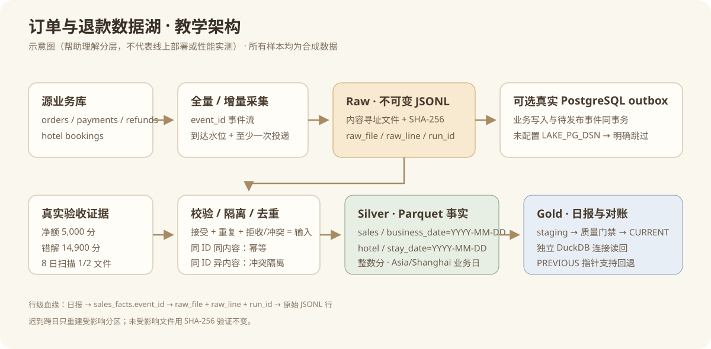
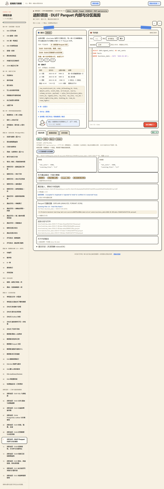
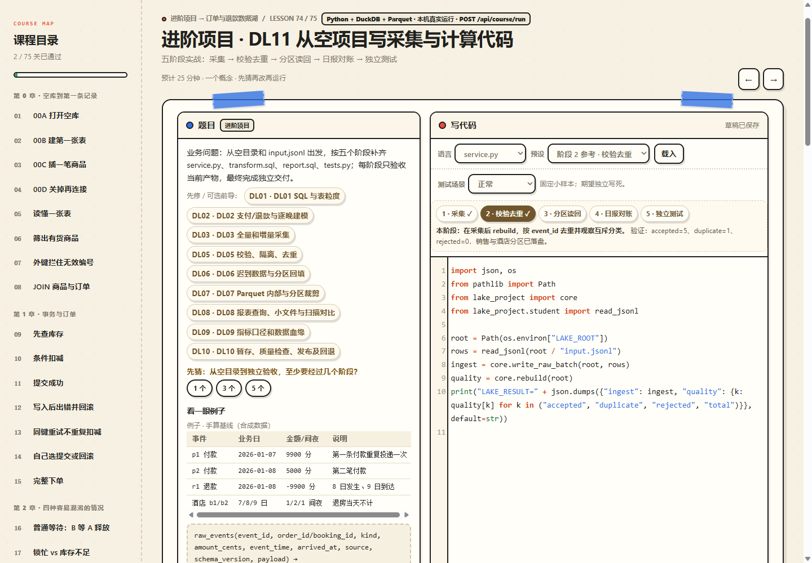
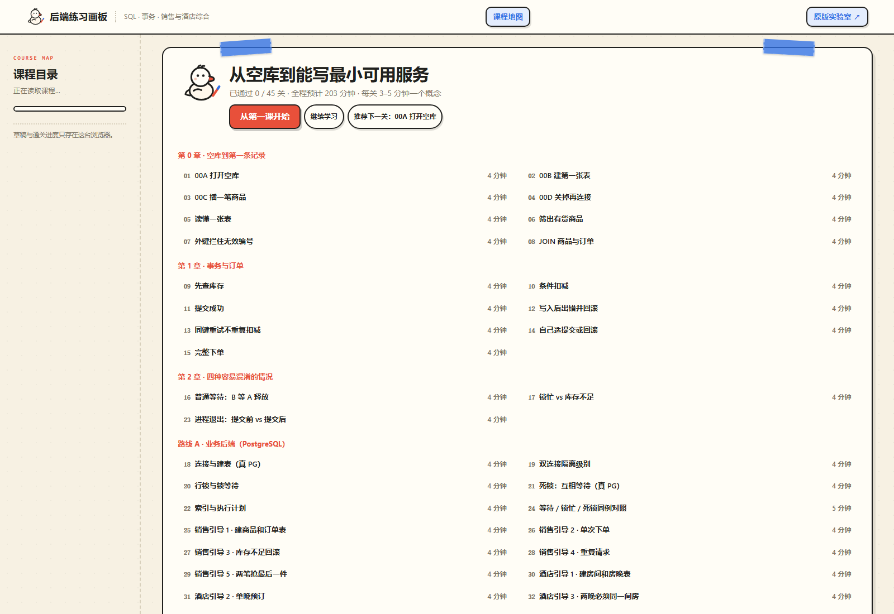

# 数据库学习实验室 | Database Learning Lab

从零学习 **SQL、事务、并发和索引**：75 关交互画板，按「一句白话 → 一个小例子 → 先猜结果 → 改一处并运行 → 看真实回放」推进。
除 **真实 PostgreSQL 实验**（隔离级别、行锁、死锁、执行计划）、**销售库存与酒店预订项目实战**、
**C++ 数据库内核选修**（存储页、缓冲池、B+ 树、查询执行、锁管理）外，新增
**进阶项目 → 订单与退款数据湖（DL01–DL12）**：用 DuckDB + Parquet 真写文件、真去重、真裁剪分区、真发布与回退。
完整数据字典、架构图、恢复手册和验收清单见 [数据湖课程交付说明](docs/data-lake/README.md)。

## 数据湖进阶项目：从原始事件到可回退日报

**原始事件 → 校验去重 → Parquet 分区 → 日报对账 → 发布回退**（发布前包含暂存与质量门禁）



*上图是教学示意，不代表性能实测。销售与酒店使用合成数据；网页结果区展示的原始行、SHA-256、分区文件、执行计划和输出值来自本次真实运行。*

DL11 在同一关内从空目录分五阶段完成，每阶段都有起始代码、短注释、参考预设和独立验收；草稿、提交历史和四文件编辑器继续复用现有画板。

| 阶段 | 学生写什么 | 实际验证 |
| --- | --- | --- |
| 1 · 采集 | `service.py` 读取 `input.jsonl`，写不可变原始批次 | 1 个已确认 manifest、6 行原始输入 |
| 2 · 校验去重 | `service.py` 调用重建，按 `event_id` 去重 | 接受 5、重复 1、拒收 0；分区落盘 |
| 3 · 分区读回 | 补发布逻辑，`transform.sql` 只查 1 月 8 日 | 净额 -4,900；真实计划 `Scanning Files: 1/2` |
| 4 · 日报对账 | 销售日报 SQL 与酒店间夜 SQL | 9,900 / -4,900，合计 5,000；间夜 1/2/1 |
| 5 · 独立测试 | `tests.py` 用独立常量核对发布报表 | 四文件真实落盘，三条断言全部通过 |

启动与复跑：

```bat
start-course.cmd
.venv\Scripts\python.exe -X utf8 scripts\verify_lake_paths.py
.venv\Scripts\python.exe -X utf8 scripts\verify_lake.py
```

打开 <http://127.0.0.1:8022/course#DL11>。以下两张是**合成数据实测截图**，不是架构示意：

**DL07：单日查询只读 1/2 个 Parquet 文件**



**DL11：五阶段从空目录实战**



旧课 `l1–l5` 保留为可选前导，重叠内容已链接到对应 DL 先修；`f1` 仍是路线 C 总挑战，不作为 DL11/DL12 的硬先修。完整对照表见 [数据湖课程交付说明](docs/data-lake/README.md#7-与旧-l1l5f1-的复用递进与先修)。



- 课程入口：`http://127.0.0.1:8022/course`（首页 `#home` 为知识地图，含进度与推荐下一关）
- 配套原实验室：`http://127.0.0.1:8021/`（销售 / 酒店两道综合题的完整事件回放）
- 仅本机运行，不连接生产数据库；所有练习使用一次性合成数据。

## 学习路线（8 章 · 75 关）

| 章 | 内容 | 关数 |
| --- | --- | --- |
| 第 0 章 · 空库到第一条记录 | 文件/连接/表 → 字段与类型 → 主键外键 → SELECT/WHERE/JOIN | 8 |
| 第 1 章 · 事务与订单 | 查库存 → 条件扣减 → 提交/回滚 → 影响行数 → 同键重试 → 完整下单 | 7 |
| 第 2 章 · 四种容易混淆的情况 | 普通等待 / 锁忙 / 死锁 / 进程退出（提交前 vs 提交后） | 4 |
| 路线 A · 业务后端（PostgreSQL） | 连接建表 → 双连接隔离 → 行锁/锁超时/死锁同例对照 → 统一锁顺序 → 执行计划与索引；销售引导 5 关 + 酒店引导 5 关 + 两个无提示综合 + 两个开写综合 | 19 |
| 路线 B · 数据库内核（C++ 教学） | 存储页 → 缓冲池 → B+ 树 → Scan/Filter/Project → 锁管理 | 5 |
| 路线 C · 云后端实战 | 请求/进程 → Outbox/幂等 → 数据湖入门 → K8s 与结课挑战 | 18 |
| 章末 · 综合应用 | 销售两笔抢最后一件、酒店连续两晚同一间（完整事件回放） | 2 |
| 进阶项目 · 订单与退款数据湖 | 事件粒度 → 增量/outbox → 校验去重 → 迟到回填 → Parquet → 日报/血缘 → 发布回退 → 独立交付 | 12 |

每关含正常 / 边界 / 典型错误三类用例；结果区显示「输入 → 预期 → 实际 → 失败原因」；
回放支持播放、单步、上一帧/下一帧、重置、跳到提交/回滚，并标明当前是 SQLite、真实 PostgreSQL 还是教学 C++。
「参考答案」Tab 默认折叠：先给提示，主动点击才展开完整解；只有同答案同场景实际跑通才标「已验证」并附运行证据。

## 安装（Windows，普通用户可照做）

1. 安装 [Python 3.10+](https://www.python.org/downloads/)（勾选 Add to PATH）。
2. 在本目录打开命令行：
   ```bat
   py -m venv .venv
   .venv\Scripts\python.exe -m pip install fastapi "uvicorn[standard]"
   ```
3. 数据湖进阶项目（DL01–DL12）需要 DuckDB 与 Asia/Shanghai 时区数据：
   ```bat
   .venv\Scripts\python.exe -m pip install -r requirements.txt
   ```
   不需要 Docker、GPU、对象存储或付费服务。真实 PostgreSQL outbox 仍为可选。
4. 可选 · 真实 PostgreSQL 实验（路线 A）：
   - 安装 [PostgreSQL](https://www.postgresql.org/download/windows/)（安装版或 binaries zip 均可），
     或用已有实例；课程只连本机隔离实验库。
   - 初始化一次性集群并建库（端口可自定，示例 55433）：
     ```bat
     "<PG目录>\bin\initdb.exe" -D tmp\pgcourse -U course --auth-host=trust -E UTF8 --locale=C
     "<PG目录>\bin\pg_ctl.exe" -D tmp\pgcourse -o "-p 55433 -h 127.0.0.1" -l tmp\pgcourse.log start
     "<PG目录>\bin\createdb.exe" -h 127.0.0.1 -p 55433 -U course course_lab
     .venv\Scripts\python.exe -m pip install "psycopg[binary]"
     ```
   - 连接串走环境变量 `COURSE_PG_DSN`（默认 `host=127.0.0.1 port=55433 dbname=course_lab user=course`）。
     未安装/未启动时，路线 A 关卡会明确标「示意 / 未实测」，不影响其余章节。
5. 可选 · C++ 内核选修（路线 B）：`.venv\Scripts\python.exe -m pip install ziglang`
   （或本机已有 g++ / MSVC），然后 `scripts\cpp_build.cmd` 构建教学引擎。
   未构建时路线 B 标「未实测」；网页不执行任意 C++，学生草稿用 `scripts\cpp_run.cmd` 本地编译后读回放。

## 启动

```bat
start-course.cmd   :: 课程 http://127.0.0.1:8022/course
start.cmd          :: 原实验室 http://127.0.0.1:8021/
```

## 测试：只跑入门 vs 跑全量

**只跑入门**（只需 fastapi + uvicorn，不装 PostgreSQL、不构建 C++）：

```bat
.venv\Scripts\python.exe -X utf8 scripts\verify_course.py 1,2,3   :: SQLite 基础 / 事务订单 / 四种混淆
```

此时路线 A / B 的关卡在页面上显示 **「跳过：未配置 PostgreSQL／未构建 C++」**，
不计失败也不计通过——那是依赖没装，不是你写错了。配置好依赖后重跑同一关即可正常判题。

**跑全量**（先按上文装好 PostgreSQL 与 C++ 编译器）：

```bat
.venv\Scripts\python.exe -X utf8 scripts\verify_course.py all     :: 旧课程全量 HTTP 回归（需 PG；未配置时接口返回跳过）
.venv\Scripts\python.exe -X utf8 scripts\verify_lake.py            :: DL01–DL12 参考解/起始解/DL11 五阶段 59 组 HTTP 验收
.venv\Scripts\python.exe -X utf8 scripts\verify_lake_paths.py      :: 独立目录累计实跑 DL11、DL12 恢复与 DL07，并核对路由数量
.venv\Scripts\python.exe -X utf8 -m lake_project.cli verify       :: 数据湖故障、恢复与血缘独立验收
.venv\Scripts\python.exe -X utf8 scripts\verify.py                 :: 原实验室 13 组回归
.venv\Scripts\python.exe -X utf8 scripts\smoke.py                  :: 两服务 + PG + C++ 冒烟
```

环境变量：`COURSE_BASE` / `ORIG_BASE` 改测试目标地址；`COURSE_PG_DSN` 改 PostgreSQL 连接；
`COURSE_SKIP_PG=1` / `COURSE_SKIP_CPP=1` 可强制模拟「未配置」以检查跳过显示；
`verify_course.py skip` 专门验证跳过语义（需对着带 SKIP 环境变量的服务跑）。
报告写入 `runs/`（本地运行产物，不入库）。

## 实测与未实测的边界

- 真实 PostgreSQL：隔离级别、行锁/锁超时（55P03）、死锁（40P01）、执行计划均在隔离实验库真跑。
- C++：教学引擎本地真编译真运行；学生草稿本地编译对照（参考 vs 错误）留证据于 `runs/cpp/`（本地产物）。
- 教学 Agent：未配置真实模型时回退「内置参考解」并标明来源；**回退不计作真实模型实测**。
- 无 PostgreSQL / 无 C++ 编译器时对应关卡标「示意 / 未实测」，不计入通过数。
- 数据湖 L0：Python 3.10.4 + DuckDB 1.5.6 本机实测；净额 5,000 分、错解 14,900 分、单日扫描 1/2 文件。
- 数据湖真实 PostgreSQL outbox 未配置 `LAKE_PG_DSN` 时明确「跳过」；Kafka/Debezium、Spark、S3/Iceberg 为「未实测」，不阻塞 L0 主线。

## 来源与许可

- 本项目教学代码（`lab/`、`static/`、`scripts/`）为原创改写，MIT 许可（见 [LICENSE](LICENSE)）。
- 销售 / 酒店两题改编自作者自有仓库
  [commerce-ledger@0659bd5](https://github.com/simonshi-stu/commerce-ledger/tree/0659bd591d3b23b05f21e07609acd3dbe8f18c8b)
  与 [hotel-reservation-lab@7151ff8](https://github.com/simonshi-stu/hotel-reservation-lab/tree/7151ff8ca479b2887706ce3f2186611a06454c1b)，
  逐关注明来源文件与函数；**原仓库快照不随本仓库分发**，练习使用内置合成种子数据，可独立运行。
- 编辑器 [CodeMirror 5](https://codemirror.net/)（MIT）随附许可声明：
  [static/vendor/LICENSE-CODEMIRROR.md](static/vendor/LICENSE-CODEMIRROR.md)。
- PostgreSQL、psycopg、ziglang 为可选外部依赖，不随仓库分发二进制。

## 目录

```
lab/            课程服务、运行引擎（SQLite / PostgreSQL / C++ / 数据湖回放）、判题与 harness
lake_project/   数据湖真实管线、学生 API、固定样本、故障验收与 CLI
lab/cpp/        C++ 教学引擎源码（五模块）
static/         画板前端与本地 CodeMirror
scripts/        构建与验证脚本（verify_course / verify_lake / verify / smoke 等）
docs/           知识地图、数据湖架构图、数据字典、恢复手册与验收截图

```