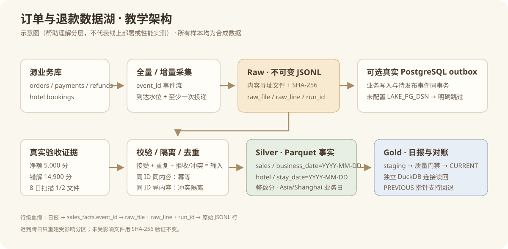

# 进阶项目 → 订单与退款数据湖

本课程已接入现有「数据库学习实验室」画板，不是独立判题系统，也不是公网演示。学生代码只在本机课程服务中执行；服务默认绑定 `127.0.0.1`，不得直接暴露到公网。

## 1. 快速开始

```bat
rem 在本仓库根目录执行
.venv\Scripts\python.exe -m pip install -r requirements.txt
start-course.cmd
```

打开 <http://127.0.0.1:8022/course>，进入「进阶项目 → 订单与退款数据湖」。

终端先跑固定样本：

```bat
.venv\Scripts\python.exe -X utf8 -m lake_project.cli demo --root runs/lake-demo
.venv\Scripts\python.exe -X utf8 -m lake_project.cli inspect --root runs/lake-demo --date 2026-01-08
.venv\Scripts\python.exe -X utf8 -m lake_project.cli verify
.venv\Scripts\python.exe -X utf8 scripts\verify_lake_paths.py
```

独立预期值写在 `lake_project/acceptance.py`，不是用学生 SQL 反推：

| 验收项 | 预期 |
| --- | --- |
| 2026-01-07 销售净额 | 9,900 分 |
| 2026-01-08 销售净额 | -4,900 分 |
| 销售净额合计 | 5,000 分 |
| 不去重 / 错误地按 order_id 去重 | 14,900 分，必须失败 |
| 酒店 7/8/9 日间夜 | 1 / 2 / 1 |
| 1 月 8 日销售查询 | `Scanning Files: 1/2`，实际读取 1 个文件 |

固定样本：1 月 7 日付款 9,900 分且重复投递一次；1 月 8 日付款 5,000 分；退款 9,900 分在 1 月 8 日发生、1 月 9 日到达。付款和退款属于同一订单，但 `event_id` 不同，不能按 `order_id` 去重。

## 2. 十二关与真实动作

| 关卡 | 学生动作 | 平台独立证据 |
| --- | --- | --- |
| DL01 | 按 `event_id` 数销售事件 | 3 个事件、2 个订单，粒度不能混淆 |
| DL02 | 展开酒店逐晚事实 | 7/8/9 日 1/2/1 间夜，退房日不计 |
| DL03 | 按 `arrived_at` 水位做增量 | 迟到业务事件不丢，重复允许传给下游 |
| DL04 | 写原始文件后再确认 outbox | 真实 PostgreSQL 隔离 schema；未配置则跳过 |
| DL05 | 改去重条件 | 接受 3、重复 1、净额 5,000；错解 14,900 |
| DL06 | 按时区派生业务日 | UTC 16:30 → 上海次日；迟到目标分区回填 |
| DL07 | 写带日期条件的 SQL | 真实 `EXPLAIN (ANALYZE, FORMAT JSON)` 显示 1/2 |
| DL08 | 写销售日报并比较小文件 | 压实 2/2 文件，逐事件小文件 3/3，结果一致 |
| DL09 | 写指标 SQL | 退款按发生日冲减，`r1` 可回到原始第 3 行 |
| DL10 | 暂存、检查、原子发布 | 发布失败时 CURRENT 和旧报表仍可读 |
| DL11 | 从空目录按五阶段交付四个文件 | 采集 → 校验去重 → 分区读回 → 日报对账 → 独立测试，逐阶段真实落盘并验收 |
| DL12 | 制造并恢复崩溃、冲突、发布失败、回填 | 不只看学生打印的 `ok`，另开连接/比对文件哈希；发布失败必须读旧版再恢复 |

每关都复用原有草稿、进度、IndexedDB 提交历史、请求序号保护、回放和「主动点击才展开参考答案」。参考解在正常、边界、坏输入场景都真实运行。

### 2.1 DL11 五阶段从零路径

五个阶段在同一个运行目录中累计完成；每次运行都会真实写入 `service.py`、`transform.sql`、`report.sql`、`tests.py`，但只验收当前阶段要求的证据。

| 阶段 | 起始代码要求 | 平台实际验证 |
| --- | --- | --- |
| 1 · 采集 | 读 `input.jsonl`，补 `core.write_raw_batch` | 1 个 confirmed manifest、6 行原始输入 |
| 2 · 校验去重 | 在采集后补 `core.rebuild` | `accepted=5`、`duplicate=1`、`rejected=0`，行数守恒，5 个 Parquet 分区文件 |
| 3 · 分区读回 | 补发布，写带日期条件的单日 SQL | 发布版可读；净额 -4,900；`Scanning Files: 1/2` |
| 4 · 日报对账 | 改销售日报 SQL，写酒店间夜 SQL | 销售 9,900 / -4,900、合计 5,000；酒店 1/2/1；独立报表一致 |
| 5 · 独立测试 | 用 `acceptance` 常量写断言 | 四文件存在，三条独立断言全部通过 |

阶段按钮、逐文件草稿和提交历史沿用原画板；切换阶段不会清空其他文件草稿。`scripts/verify_lake_paths.py` 在独立临时目录中按 1→5 顺序累计实跑，并核对原始文件仍只有 1 个。

### 2.2 DL12 发布失败恢复路径

`publish_fail` 场景要求学生依次完成：

1. 记录旧 CURRENT，并用独立连接读旧报表。
2. 调用 `core.publish(root, force_fail=True)` 制造发布失败。
3. 再读 CURRENT 和旧报表，证明指针与内容都没变。
4. 调用 `core.publish(root)` 重新发布，证明 CURRENT 前进且新报表可读。

平台同时复核 `failed_published=false`、`old_readable=true`、`recovered=true`，不会只相信学生输出的 `ok`。

## 3. 架构



上图是**示意图**，用于解释分层；网页结果区的文件路径、SHA-256、原始行、执行计划和输出值来自本次真实运行。

实测截图（均为合成数据）：

- [DL07 单日查询 `1/2`](evidence/lake-dl07-pass.png)
- [DL11 五阶段从零实战](evidence/lake-dl11-stages.png)
- [DL11 390px 移动布局](evidence/lake-dl11-mobile.png)

```text
源业务库 / 合成事件
  → 全量或到达水位增量
  → raw/batches/*.jsonl（内容寻址、不可变）
  → 校验 / 隔离 / event_id 去重
  → silver/sales/business_date=YYYY-MM-DD/*.parquet
  → silver/hotel/stay_date=YYYY-MM-DD/*.parquet
  → staging / 质量门禁 / CURRENT
  → 独立 DuckDB 连接读日报与对账
```

真实 PostgreSQL 阶段把待发布事件放进业务事务的 outbox。文件系统确认与数据库确认之间仍可能崩溃，因此下游必须按 `event_id` 幂等，而不是假设消息绝不重复。

## 4. 数据字典

### 4.1 原始事件 `raw_events`

| 字段 | 类型 | 约束与含义 |
| --- | --- | --- |
| `event_id` | string | 事件身份；同 ID 同内容为重复，同 ID 异内容为冲突 |
| `order_id` | string | 销售订单号；不是事件主键 |
| `booking_id` | string | 酒店预订号 |
| `kind` | string | `payment` / `refund` / `hotel_booking` |
| `amount_cents` | integer | 整数分；不使用浮点金额 |
| `event_time` | timestamptz | 事件发生时间，决定业务日 |
| `arrived_at` | timestamptz | 到达时间，决定增量水位和最早有效投递 |
| `source` | string | 来源域，销售和酒店分开 |
| `schema_version` | integer | 原始 schema 版本 |
| `payload` | object | 酒店 `room_id/check_in/check_out` 等扩展字段 |

坏行进入隔离证据，不进入事实层。分类互斥：`accepted + duplicate + rejected/conflict = total`。

### 4.2 销售事实 `sales_facts`

| 字段 | 含义 |
| --- | --- |
| `business_date` | `event_time` 按 `Asia/Shanghai` 映射的日期；Hive 分区列 |
| `event_id` | 唯一销售事件身份 |
| `order_id` / `kind` | 订单与付款/退款类型 |
| `amount_cents` | 原始非负整数分 |
| `signed_cents` | 付款为正、退款为负 |
| `event_time` / `arrived_at` | 发生与到达时间 |
| `source` / `schema_version` | 来源与版本 |
| `attributes` | 原始扩展字段 JSON；新增可空字段可保留 |
| `raw_file` / `raw_line` | 原始文件与一基行号 |
| `run_id` | 写入该原始行的采集运行 ID |
| `payload_sha256` | 去除传输字段后的内容哈希 |

### 4.3 酒店房晚事实 `hotel_nights`

| 字段 | 含义 |
| --- | --- |
| `stay_date` | 入住夜日期；Hive 分区列 |
| `booking_id` / `room_id` | 预订与房间 |
| `event_id` | 来源预订事件 |
| `room_nights` | 每晚一行、每行 1 间夜 |
| `check_in` / `check_out` | 右端为 `check_out - 1 day`，退房当天不计 |
| `raw_file` / `raw_line` / `run_id` | 行级血缘 |

### 4.4 发布目录

| 路径 | 含义 |
| --- | --- |
| `raw/batches/*.jsonl` | 不可变原始文件，文件名带内容哈希前缀 |
| `raw/manifests/*.json` | 行数、SHA-256、来源、run_id 等清单 |
| `raw/manifests/*.confirmed` | 原始文件持久化后的确认标记 |
| `quarantine/` | 拒收、冲突与重复证据 |
| `quality/latest.json` | 行数守恒、唯一性、冲突等质量结果 |
| `published/staging/<version>/` | 未切换的候选报表 |
| `published/CURRENT` | 当前有效版本指针 |
| `published/PREVIOUS` | 上一有效版本指针 |

## 5. 恢复手册

### 同批重跑

```bat
.venv\Scripts\python.exe -X utf8 -m lake_project.cli demo --root runs/lake-demo
```

内容哈希相同不会覆盖原始文件；下游按 `event_id` 去重，日报保持 5,000 分。

### 写原始文件后、确认前退出

```bat
.venv\Scripts\python.exe -X utf8 -m lake_project.cli worker --root runs/lake-crash --crash-after-raw
```

该命令故意以退出码 `73` 结束。再次投递同一批次，平台补确认并重放；不得手工修改 `.confirmed` 来掩盖崩溃。

### 同 ID 不同内容

先停止自动发布，检查 `quarantine/` 与 `quality/latest.json`。冲突未解决时不得切 CURRENT；修复源数据或明确选择有效版本后，再重新构建和发布。

### 发布失败 / 错误版本回退

```bat
.venv\Scripts\python.exe -X utf8 -m lake_project.cli rollback --root runs/lake-demo
```

回退只切指针，不删除新旧版本目录。读者用独立连接读取 CURRENT，因此不会看到 staging 半成品。

### 迟到跨日回填

```bat
.venv\Scripts\python.exe -X utf8 -m lake_project.cli backfill --root runs/lake-demo --date 2026-01-06
```

只重建指定业务日分区；平台比较未受影响分区 SHA-256。退款仍记在 `event_time` 的业务日，不记在 `arrived_at` 的日期。

### 空批 / 全坏批

空批允许重跑，销售和酒店结果保持 0，不伪造金额。全坏批必须全部隔离且不发布新版本；若此前已有有效版，CURRENT 保持不变。

## 6. 依赖与实测边界

| 组件 | 本机版本/状态 | 用途 |
| --- | --- | --- |
| Python | 3.10.4 | 课程服务、采集与验收 |
| DuckDB | 1.5.6 | SQL、Parquet、执行计划与独立读回 |
| tzdata | 2026.6 | Windows `Asia/Shanghai` 时区 |
| FastAPI / Uvicorn | 现有课程环境 | 本机 HTTP 画板 |
| PostgreSQL / psycopg | 未配置 `LAKE_PG_DSN`，**跳过** | DL04 隔离 schema outbox 真实验收 |
| Kafka / Debezium | **未实测** | L2 CDC 投递 |
| Spark | **未实测** | L2 分布式转换 |
| S3 / Iceberg | **未实测** | L2 对象存储与表格式 |

L2 按以下顺序在真实隔离环境复现，不阻塞 L0：

1. Kafka/Debezium：启动隔离 Kafka Connect，创建 source connector，从 outbox/WAL 产生事件；用消费者组重放并确认 `event_id` 幂等。
2. Spark：用 `spark-submit` 读取原始 JSONL，按相同校验/去重/业务日规则写 Parquet，再对 5,000 分基线对账。
3. S3/Iceberg：配置隔离 bucket、catalog 和 warehouse，建 Iceberg 表并执行 snapshot/rollback；核对分区文件和行级血缘。

以上三步没有在本机搭建，不能标为通过。

## 7. 与旧 l1–l5、f1 的复用、递进与先修

旧课保留原注册与草稿历史，不删除、不另建平行练习。重叠内容并入 DL 主线，旧课改为页面上的可选先修链接；`f1` 仍是路线 C 总挑战，不作为 DL11/DL12 的硬先修。

| 旧课 | 与新课程的重叠 | 处理与先修链接 |
| --- | --- | --- |
| `l1` 原始 vs 业务库 | DL01 事件粒度、DL03 采集、DL04 原始层稳定 | 保留为可选前导；链接到 DL01/DL03/DL04 |
| `l2` 校验坏记录 | DL05 校验、隔离、去重；DL10 质量门禁 | 内容并入 DL05；`l2` 作为 DL05 先修 |
| `l3` Parquet 分区 | DL07 分区裁剪；DL08 小文件对照 | 用 DL07 的 `1/2` 实测强化替代；`l3` 作为 DL07 先修 |
| `l4` 重跑不重复 | DL05 去重、DL06 迟到/业务日、DL12 故障重跑 | 拆成递进关卡；`l4` 作为 DL06 先修 |
| `l5` 改口径重建 | DL08 销售日报、DL09 口径血缘、DL10 重建发布 | 酒店间夜回归 DL02；`l5` 作为 DL08/DL09 先修 |
| `f1` 同一订单贯穿 | DL11 独立交付、DL12 独立故障验收 | 保留为路线 C 总挑战；不阻塞 DL 主线 |

DL 主线先修关系：`DL01→DL03/DL05`，`DL02→DL08/DL11`，`DL03→DL04/DL05/DL06`，`DL05+DL06→DL07`，`DL07→DL08`，`DL06+DL08→DL09`，`DL05+DL08+DL09→DL10`，`DL01–DL10（DL04 可选）→DL11`，`DL03+DL05+DL06+DL10+DL11→DL12`。

数量核对（接口实测，不是按文档猜）：

| 项目 | 数量 |
| --- | --- |
| 课程注册条目 | 75 |
| 章节 | 8 |
| 数据湖课程条目 / hash 路由 | 12（`#DL01`–`#DL12`） |
| 旧 `l1–l5/f1` 条目 / hash 路由 | 6 |
| 页面 | 2：原实验室 `/`、课程画板 `/course` |
| 课程相关 HTTP 端点 | 5：`/course`、`/api/course`、`/api/course/run`、`/api/course/assist`、`/api/course/cpp-replay` |
| 前端 hash 路由状态 | 76：75 个课程 ID + `#home` |

DL 课程共用 `/api/course/run`，不是 12 个独立 HTTP 路径。核对脚本：`scripts/verify_lake_paths.py`。

## 8. 验收证据

- [附件独立实验正确基线](evidence/attachment-baseline-windows.txt)
- [附件独立实验错误基线](evidence/attachment-baseline-wrong.txt)
- [课程地图截图](evidence/lake-course-map.png)
- [DL07 参考解 1/2 扫描截图](evidence/lake-dl07-pass.png)
- [DL11 五阶段从零实战截图](evidence/lake-dl11-stages.png)
- [DL11 390px 移动布局截图](evidence/lake-dl11-mobile.png)
- [浏览器交互检查](evidence/browser-check.json)
- [十二关 HTTP 验收日志](evidence/lake-course-verify.txt)
- [DL11/DL12/DL07 独立目录验收日志](evidence/lake-paths.txt)
- [数据湖独立矩阵](evidence/lake-matrix.txt)
- [原销售/酒店回归日志](evidence/original-lab-regression.txt)
- [旧课基础/事务/混淆冒烟](evidence/old-course-entry.txt)
- [旧课全量回归日志](evidence/old-course-all.txt)

本次结果：

- DL01–DL12 网页同款路由：59/59 组符合预期；39 组参考解通过、16 组起始解按预期失败、4 组 DL04 因未配置 PostgreSQL 跳过（3 组参考解、1 组起始解）。
- DL11 五阶段独立目录累计实跑：5/5；同一目录只生成 1 个原始文件，最终净额 5,000。
- DL12 独立目录恢复：崩溃、冲突、发布失败、迟到回填 4/4；发布失败场景证实旧版可读并恢复。
- DL07 独立目录：`Scanning Files: 1/2`，实际读取 1 个文件。
- 数据湖独立矩阵：12 项通过、1 项跳过、1 项未实测，失败 0。
- 原销售/酒店实验室：13/13。
- 旧课程基础/事务/混淆：21/21。
- 旧课程全量：可测量 40 组全部通过；另外 40 组因本机 PostgreSQL 未启动而返回跳过，全量脚本将这些依赖缺失计为非通过，不能把 80/80 当作实测。
- 浏览器：错误解失败、参考解通过、真实回放、刷新恢复草稿、主动展开答案、390px 无横向溢出、控制台无错误。

运行产物位于 `runs/`，已由 `.gitignore` 排除；交付仓库只保留代码、文档和截图，不包含学生运行数据或连接密钥。
